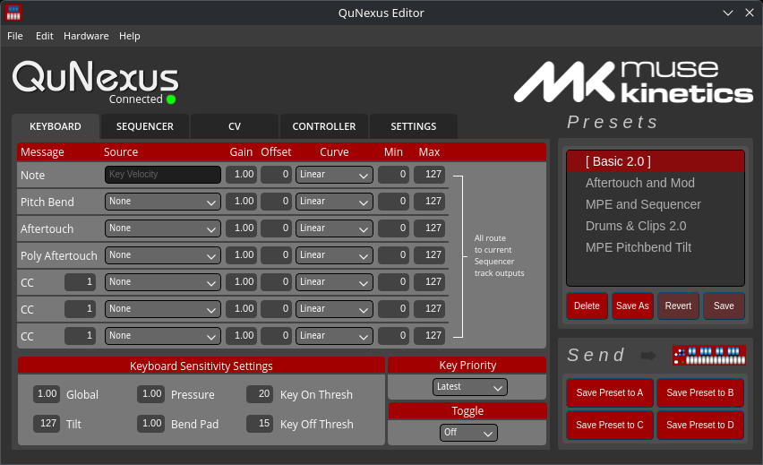

# QuNexus Editor for Linux

A Linux build of the [QuNexus Editor](https://github.com/Muse-Kinetics/qunexus-qt6) from Muse Kinetics, the editor for the QuNexus MIDI keyboard. It's made for Debian 13 (trixie), and it should build on any Linux with Qt 6.



With it you can edit presets, key sensitivity, CV trims and global settings, send presets to the QuNexus and update its firmware, the same as the macOS and Windows versions.

## Install

On Debian trixie (amd64 or arm64), add my apt repo and install it:

```bash
sudo mkdir -p /etc/apt/keyrings
sudo curl -fsSLo /etc/apt/keyrings/hunke.asc https://hunke.ws/apt/hunke.asc
echo "deb [signed-by=/etc/apt/keyrings/hunke.asc] https://hunke.ws/apt stable main" | sudo tee /etc/apt/sources.list.d/hunke.list
sudo apt update
sudo apt install qunexus-editor
```

Or download the `.deb` for your machine from the [latest release](https://github.com/roge-rm/qunexus-qt6/releases/latest) and install it with `sudo apt install ./qunexus-editor_*.deb`.

It shows up in your menu as QuNexus Editor, or run `qunexus-editor`. The manual, firmware files and DAW support files go in `/usr/share/doc/qunexus-editor`.

Plug in the QuNexus and it connects by itself. The editor uses the ALSA sequencer, so if it says it couldn't open MIDI, run `sudo modprobe snd-seq`.

## Build from source

On Debian trixie:

```bash
sudo apt install build-essential qmake6 qt6-base-dev qt6-declarative-dev qt6-declarative-dev-tools libasound2-dev
git clone --recurse-submodules -b linux https://github.com/roge-rm/qunexus-qt6.git
cd qunexus-qt6
linux-deploy/build-deb.sh
sudo apt install ./build/qunexus-editor_*_$(dpkg --print-architecture).deb
```

`linux-deploy/build-deb-arm64.sh` cross-builds the arm64 package in a Docker container.

On other distros, install Qt 6 (base and declarative) and the ALSA headers, then build it with `qmake6` and `make` in a `build` folder.

## What's different from upstream

- Fixes a crash on Linux when reading MIDI port names, and reads ALSA port names properly so it finds the QuNexus.
- Shows a message instead of crashing when the ALSA sequencer isn't there.
- Debian packaging, a desktop entry and an icon.
- The `KMI_MIDI_Device_Manager` submodule points at [my fork](https://github.com/roge-rm/kmi_midi_device_manager) for the port name fix, and the submodules clone over https.

The work is on the `linux` branch. `main` follows upstream. The original README is in [README-upstream.md](README-upstream.md).

## Licence

MPL-2.0, the same as upstream. See [LICENSE](LICENSE). The QuNexus Editor is by KMI Music, Inc. (Muse Kinetics). This fork isn't affiliated with them, so for help with the QuNexus itself go to https://support.musekinetics.com, and for problems with the Linux build open an issue here.
